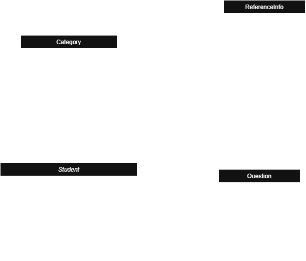

# Проєктування системи stud_helper_bot (v1.0)

Цей документ містить опис архітектурних рішень та UML-моделей першої версії Telegram-бота для інформаційного супроводу студентів.

## 1. Діаграма класів (Class Diagram)

На діаграмі виділено базові логічні сутності предметної області без прив'язки до технічних бібліотек Telegram API:
- **`Student`** — представляє користувача бота, ініціює вибір розділу меню, пошук контактів та створення звернень.
- **`Category`** — основні розділи навігаційного меню («Навчання», «Гуртожиток»).
- **`ReferenceInfo`** — одиниця зведеної довідкової інформації за розділом, яка містить текст, посилання на офіційний ресурс (`sourceUrl`), ключові слова та дату останнього оновлення (`updatedAt`).
- **`Question`** — сутність запитання користувача, яке пересилається адміністратору.

---

## 2. Обґрунтування відсутності State Machine Diagram

У версії v1.0 діаграма станів (State Machine Diagram) не створюється, оскільки жодна з предметних сутностей не має складного життєвого циклу, від якого залежить дозволена поведінка системи. Довідкова інформація (`ReferenceInfo`) використовується виключно для читання, а запитання студента (`Question`) після створення одразу переадресовується адміністратору без проміжних статусів обробки чи модерації в межах бота.